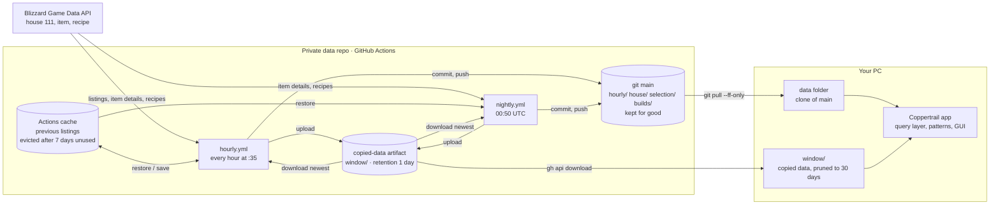
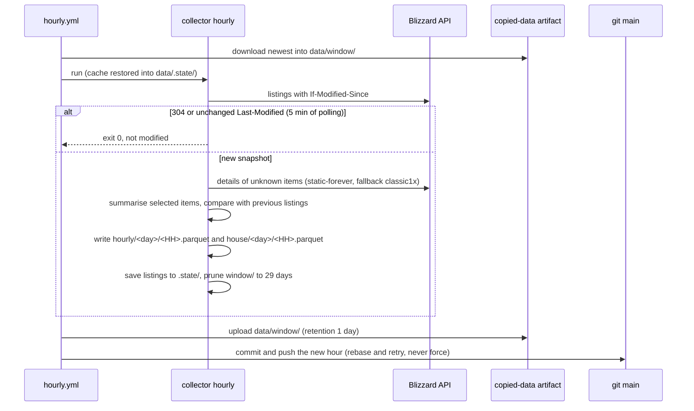
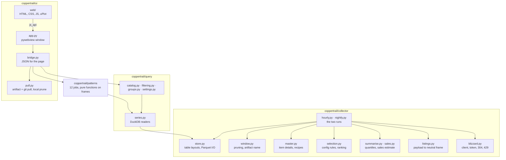

# Architecture

Coppertrail reads the WoW Forever auction house (Normal, Alliance, EU, house 111) from
Blizzard's Game Data API once an hour, keeps its own conclusions for the long term, and
shows patterns in a desktop app. Two kinds of data are kept apart, because they have
different lifecycles:

| | Our conclusions | Copied from Blizzard |
|---|---|---|
| What | hourly per-item prices (min, quartiles, median), quantity, sales estimate; house totals per snapshot; item selection; game builds | item details (name, quality, class, vendor price), recipes; the previous listings snapshot |
| Kept | for good (`summary_retention_days = 0`) | at most 30 days (Blizzard's API terms) |
| Stored in | git: the private data repo's `main` branch | never git: a GitHub Actions artifact and the Actions cache, both deleted by GitHub |
| Locally | the data folder (a clone of `main`) | `<data>/window/` (gitignored), pruned at every app start and pull |

## Overview



## One hourly run



The nightly run is the same frame: it first looks up every listed item that has no
details yet (up to 8,000, so the rules see real quality and class instead of
"unclassified"), then rebuilds `selection/<day>.parquet` from the latest listings,
refreshes item details older than 7 days and the recipes on Mondays,
applies `summary_retention_days`, prunes `window/`, uploads the artifact and commits main.

## Why no copy outlives 30 days

- Rows in `window/` are dropped once they are `copied_days - artifact_days` days old
  (30 − 1 = 29), at every hourly and nightly run, so even when the nightly run fails,
  every upload is within the limit.
- GitHub deletes each artifact `artifact_days` (1) after upload. The newest artifact is
  always at most an hour old, so nothing is lost while the workflows run. If they stop,
  everything copied expires within a day, and the next run fetches it again.
- The previous listings in the Actions cache are overwritten every run and evicted after
  7 days unused; the collector also ignores a state older than 30 days.
- On the PC, the app prunes `window/` to `copied_days` at start and after each pull, and
  each pull replaces the folder with the newest artifact.
- `main` holds item ids and our own numbers only, no copied text, so it never expires.

`collector.toml` holds `copied_days` and `artifact_days`; the workflows' upload step holds
`retention-days`, which must equal `artifact_days`.

## Local layout

```
<data>/                        clone of the data repo's main (git pull --ff-only)
├── collector.toml             [blizzard] [selection] [retention]
├── hourly/<day>/<HH>.parquet  one row per selected item per snapshot, write-once
├── house/<day>/<HH>.parquet   one row per snapshot for the whole house
├── selection/<day>.parquet    the item list the hourly run stores
├── builds/<day>.parquet       namespaces seen, with first_seen
├── handover/                  product spec and design package
└── window/                    NOT in git: the copied-data artifact, pruned to 30 days
    └── blizzard/
        ├── items/<day>.parquet
        └── recipes/<day>.parquet
```

A new data source would get its own folder next to `window/blizzard/`. Our own tables
stay source-neutral and record the feeding source in a `source` column.

## Code map



Source-specific code stays in `blizzard.py`, `listings.to_frame` and `master.py`.
Everything after them works on neutral frames, so the patterns and the GUI never see
the API.

## Rules that hold everywhere

- The public code repo ships no data: no auction data in commits, fixtures, logs or
  artifacts. Workflows run only in the private data repo.
- The API credentials come from the environment or `blizzard.toml` in the user's config
  folder, and are never logged.
- The app's only network action is "Pull latest data", and only on click.
- No Qt; the GUI is pywebview with plain HTML/CSS/JS.
